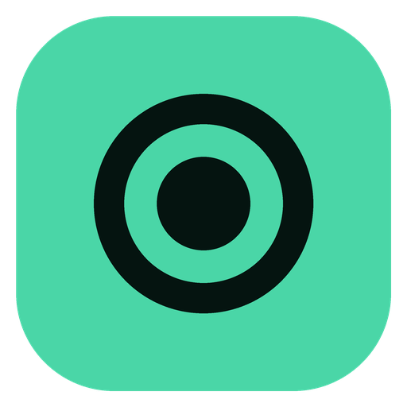
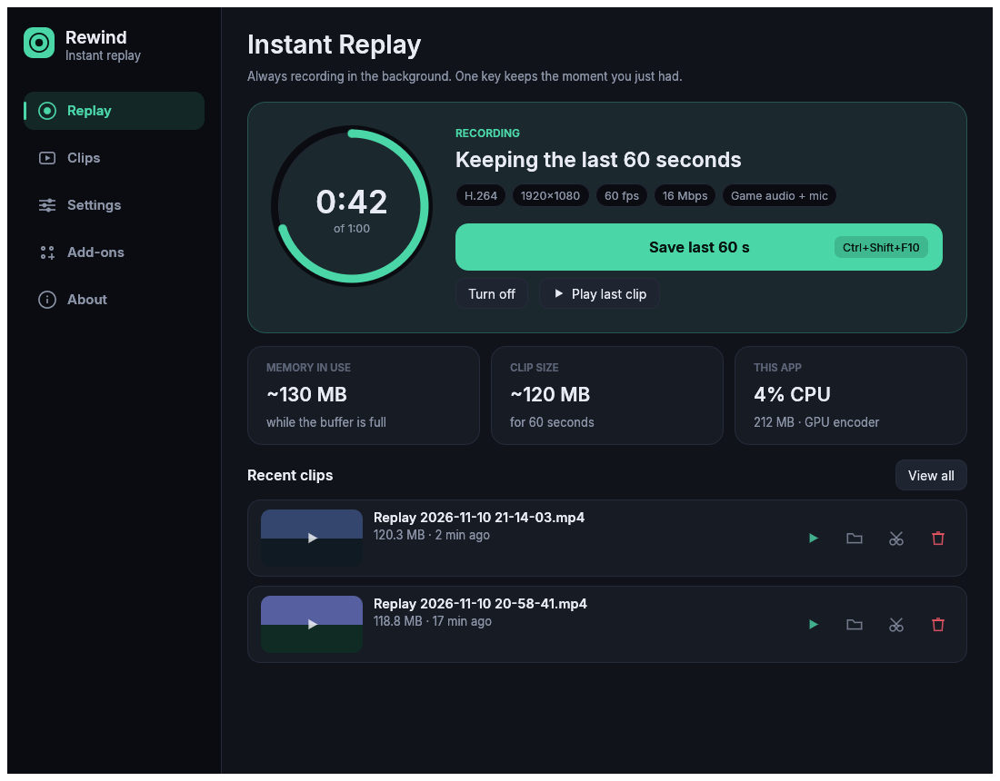
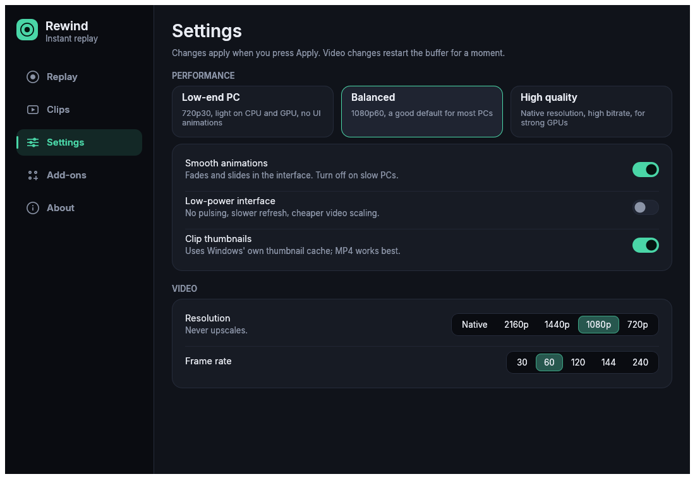
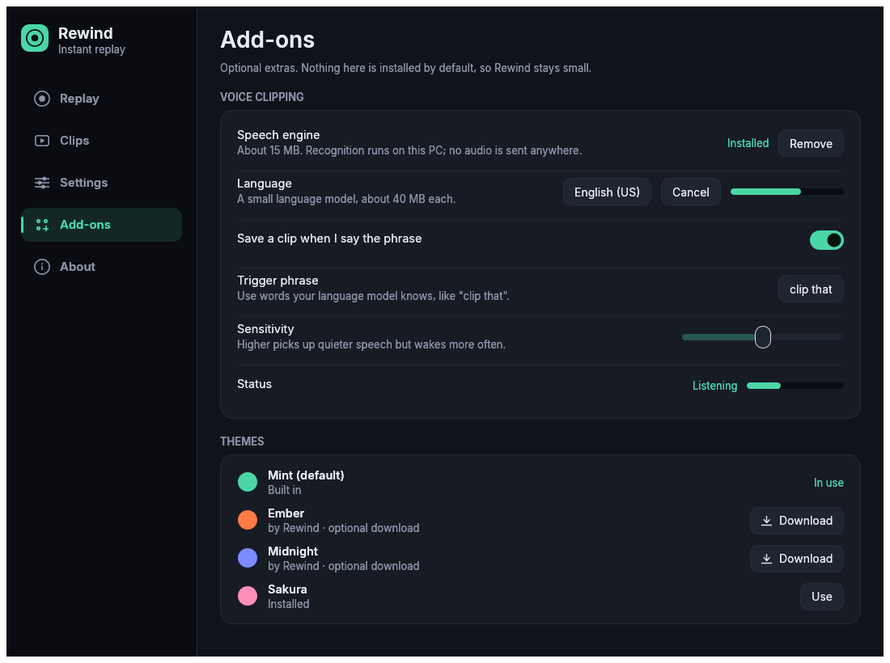
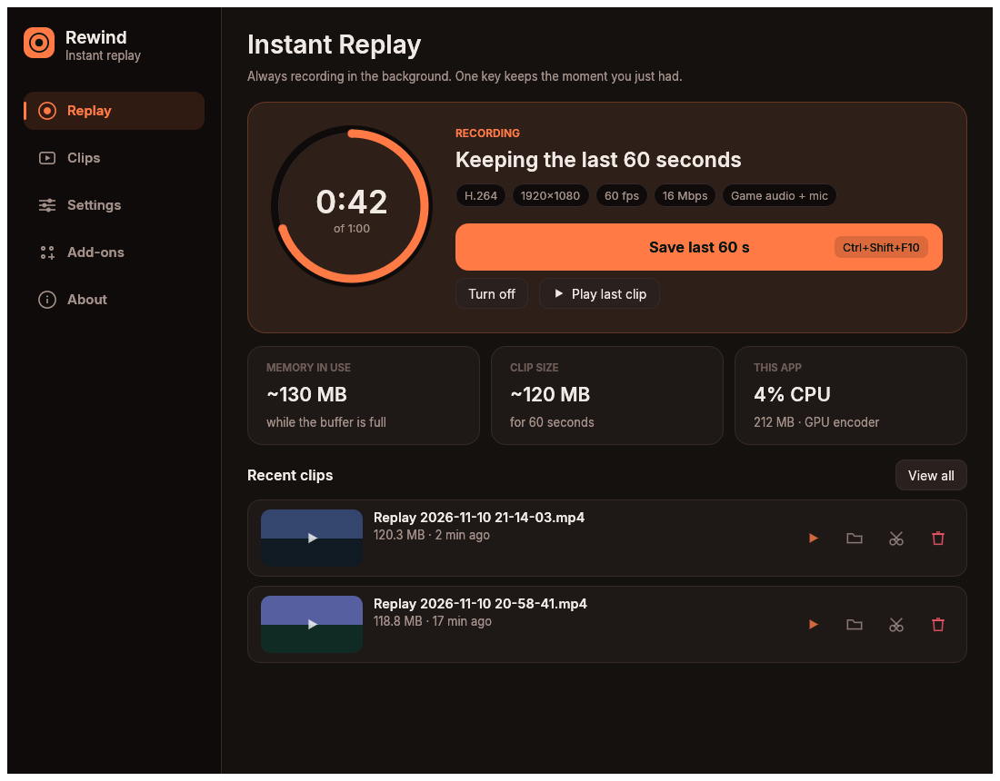
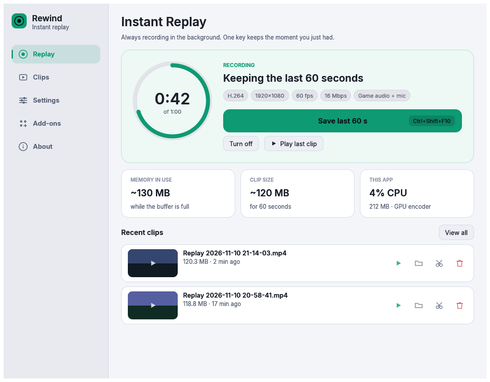

<p align="center">
  
</p>

<h1 align="center">Rewind</h1>

<p align="center">
  A small, fast <b>instant-replay recorder for Windows</b>, written in Rust.<br>
  It keeps the last moments of your screen and sound ready, so one key saves the clip you wish you'd recorded.
</p>

<p align="center">
  <a href="../../actions/workflows/ci.yml"></a>
  <a href="../../releases/latest"></a>
  
  
</p>

<p align="center">
  
</p>

> **Status: early release.** The core logic is unit-tested and the whole app compiles and lints clean in CI, but capture, audio, hotkeys, the tray and the overlay need real-world testing on more PCs. Please [open an issue](../../issues/new/choose) when something misbehaves. That's the fastest way to make it solid.

## Why Rewind

- **Whole screen and sound, like ShadowPlay.** Captures your monitor *and* follows you into fullscreen games, with game/desktop audio and an optional microphone mixed in.
- **Works on any GPU.** Hardware encoding (NVIDIA NVENC, AMD AMF, Intel Quick Sync) through libobs, with a CPU fallback.
- **Light on slow PCs.** A one-click **Low-end preset**, a cheap video scaler, a UI that doesn't redraw when nothing changes, and a live CPU/RAM readout so you can see what it costs. See [docs/PERFORMANCE.md](docs/PERFORMANCE.md).
- **Stays small.** Voice clipping and extra themes are **optional downloads**, not part of the installer.
- **Private.** Clips never leave your PC. The only network use is optional add-on downloads from this repo.

## Features

| | |
|---|---|
| **Instant Replay** | Rolling buffer of the last 10 s to 10 min. Save with a global hotkey that works inside games. |
| **System tray** | Closing the window keeps recording. Save, toggle or quit from the tray. Optional start-with-Windows (hidden). |
| **In-game notifications** | A "Replay saved" toast over borderless/windowed games, hidden from your recordings. Plus an optional sound that works everywhere. |
| **Clip library** | Video **thumbnails** (from Windows' own thumbnail cache), search, play, show in folder, lossless trim, Recycle Bin delete. |
| **Smooth UI** | Fades, staggered lists, sliding navigation and a live buffer ring, plus eased smooth scrolling and five switchable toggle celebrations. **Each can be switched off** for slow PCs. |
| **Voice clipping** *(optional add-on)* | Say "clip that" to save. Runs offline on your PC; the engine and a small language model download on demand. |
| **Themes** *(optional add-ons)* | Mint (built in) plus downloadable themes, or [make your own](docs/THEMES.md). |
| **Presets** | Low-end PC, Balanced and High quality, in one click. |

<p align="center">
  
  
</p>
<p align="center">
  
  
</p>
<sub>Screenshots are rendered from Rewind's own widget code; thumbnails are placeholders.</sub>

## Install

1. Download **`Rewind-Setup-x.y.z.exe`** from the [latest release](../../releases/latest) and run it. No administrator rights are needed; it installs for your user.
2. Prefer no installer? Use **`Rewind-portable-x64.zip`**: unzip anywhere and run `Rewind.exe`.

Both include everything Rewind needs, including the OBS capture runtime, so **nothing is downloaded on first launch**.

Windows will show a SmartScreen or antivirus warning for new, unsigned apps. See [docs/ANTIVIRUS.md](docs/ANTIVIRUS.md) for why, how to verify your download, and how to report false positives.

**Requirements:** Windows 10 (1809+) or 11, 64-bit. Any GPU from the last decade works; modern NVIDIA/AMD/Intel GPUs encode in hardware. PCs without a hardware encoder record H.264 on the CPU, which is fine for 720p30.

Rewind captures with **DXGI Desktop Duplication**, so Windows 10 doesn't draw its yellow "recording" border around the screen. Windows Graphics Capture is still available as a fallback in Settings.

## Quick start

| | |
|---|---|
| **Save the last N seconds** | <kbd>Ctrl</kbd>+<kbd>Shift</kbd>+<kbd>F10</kbd> |
| **Turn the buffer on/off** | <kbd>Ctrl</kbd>+<kbd>Shift</kbd>+<kbd>F9</kbd> |

Both are rebindable in **Settings, Hotkeys** (click the field, press the keys). Clips are saved to `Videos\Rewind` by default.

**On an older laptop?** Open **Settings** and click **Low-end PC**, then **Apply**. It records 720p30 with the lightest encoder settings and turns off animations, smooth scrolling, toggle effects and thumbnails. Rewind also applies this automatically on first launch on a PC with four or fewer CPU threads.

## Notifications over games

Rewind draws a small always-on-top, click-through toast in the corner you choose, excluded from screen capture so it never appears in your clips.

Windows doesn't let any app draw over a game in **exclusive fullscreen** (it would have to inject code into the game, which anti-cheat can ban). Use *borderless / fullscreen windowed* mode for the toast; the **save sound** works in every game.

## Optional add-ons

Open the **Add-ons** page. Nothing is installed by default.

- **Voice clipping**: download the speech engine (about 15 MB) and a language (about 40 MB), turn it on, and say your phrase. A noise gate keeps recognition idle during silence, so it costs almost no CPU. Recognition happens on your PC; no audio is sent anywhere. Powered by [Vosk](https://alphacephei.com/vosk/).
- **Themes**: pick one to download, or drop your own `.toml` into the themes folder. See [docs/THEMES.md](docs/THEMES.md).

Add-ons are downloaded from this repository's releases, only over HTTPS from GitHub hosts, and verified against a SHA-256 before use.

## Trimming clips

Trimming is lossless (no re-encoding) and needs `ffmpeg.exe` next to `Rewind.exe` or on your `PATH`. It's optional; everything else works without it.

## FAQ

**It uses a lot of CPU.** Check **THIS APP** on the Replay page. If it says *CPU encoder*, your PC has no usable hardware encoder; apply the **Low-end PC** preset. Details in [docs/PERFORMANCE.md](docs/PERFORMANCE.md).

**Thumbnails are blank.** Windows only generates thumbnails for formats it has a codec for. MP4/H.264 works everywhere; HEVC/AV1 need Microsoft's codec extensions; MKV has no built-in thumbnailer.

**The toast doesn't show in my game.** The game is probably in exclusive fullscreen. Switch it to borderless/windowed, or rely on the save sound.

**Voice doesn't trigger.** Use words your language model knows, raise **Sensitivity**, and check the level meter on the Add-ons page moves when you speak.

**Does Rewind phone home?** No. There is no telemetry or account. The network is used only for optional add-on downloads you start.

## Build from source

```powershell
# Windows, Rust 1.95+ with the MSVC toolchain
git clone https://github.com/cinarsavas/rewind
cd rewind
cargo build --release -p rewind      # target\release\rewind.exe
cargo test -p rewind-core            # runs on any OS
```

A source build downloads the OBS runtime the first time it runs. The release workflow bundles it instead. To make an installer yourself, see [docs/PUBLISHING.md](docs/PUBLISHING.md).

Project layout and design notes: [docs/ARCHITECTURE.md](docs/ARCHITECTURE.md). Contributions are welcome: [CONTRIBUTING.md](CONTRIBUTING.md).

## Credits and license

Rewind is licensed **GPL-3.0-or-later** (see [LICENSE](LICENSE)). That matches its dependencies: libobs-rs is GPL-3.0 and OBS Studio is GPL-2.0-or-later. It builds on libobs from [OBS Studio](https://obsproject.com) via [libobs-rs](https://github.com/libobs-rs/libobs-rs), [egui](https://github.com/emilk/egui), [Vosk](https://alphacephei.com/vosk/) (optional) and the [Inter](https://rsms.me/inter/) typeface. Full list: [THIRD_PARTY_NOTICES.md](THIRD_PARTY_NOTICES.md). Rewind isn't affiliated with NVIDIA or the OBS Project.

The installer and portable zip contain unmodified OBS Studio binaries, whose source is available at <https://github.com/obsproject/obs-studio>.
